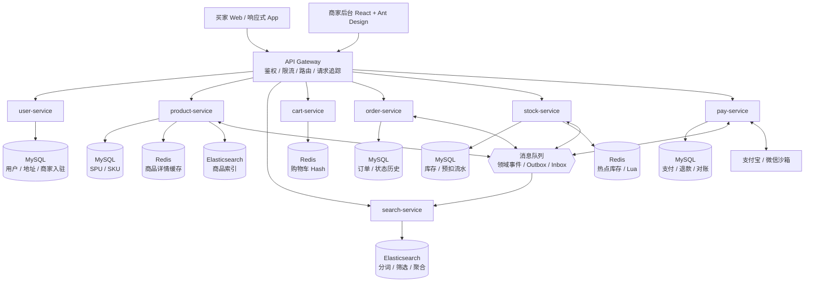
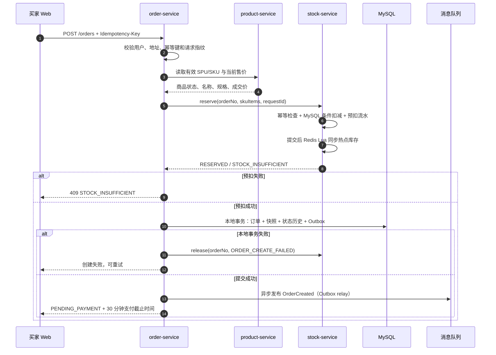
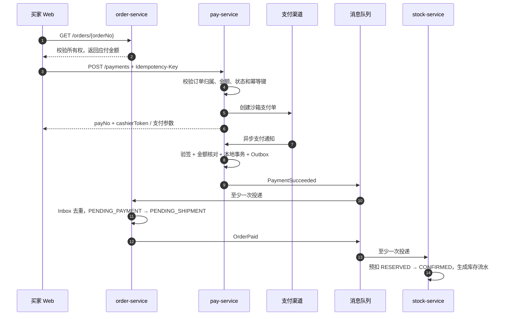
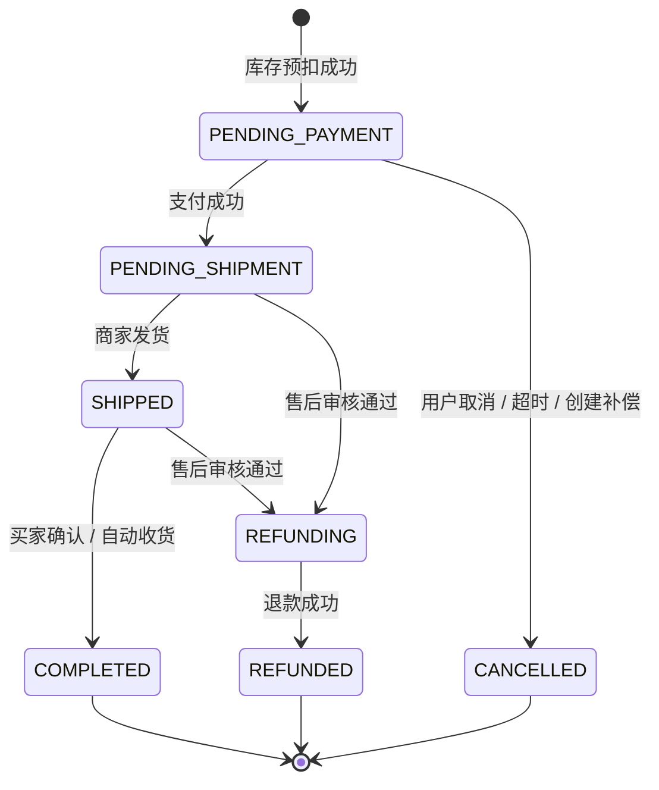

# ByteMall 系统架构设计

## 1. 背景与目标

ByteMall 支持买家跨商家购物和商家独立经营。系统按业务边界拆分为用户、商品、搜索、购物车、订单、库存和支付服务，通过 API 网关向买家 Web 与商家后台提供统一入口。

设计目标：

- **边界清晰**：每项数据只有一个权威写入服务，其他服务通过 API 或事件获取。
- **交易正确**：不超卖、不重复创建订单/支付单，失败流程可以补偿，重复消息不会重复迁移状态。
- **读路径高效**：商品读缓存、ES 搜索、Redis 购物车与库存热点加速。
- **可演进**：前后端以版本化 API 解耦，MQ 产品、支付渠道和后端语言可替换。
- **可诊断**：请求、消息、订单、支付和库存操作可以用统一链路标识串联。

### 1.1 非目标

当前设计不承诺跨服务强一致的分布式事务，不引入 XA；不将 Redis 或 ES 作为订单、支付等财务数据的最终真相；不在浏览器中完成可信鉴权、支付验签或库存校验。

### 1.2 角色

| 角色 | 能力 |
| --- | --- |
| 游客 | 浏览首页、搜索、查看商品；登录后使用购物车、结算和订单 |
| 买家 `BUYER` | 管理个人资料和地址、购物车、下单、支付、取消、确认收货、申请入驻 |
| 商家 `MERCHANT` | 管理本商家店铺、SPU/SKU、库存和订单发货；不能访问其他商家数据 |
| 平台运营 `ADMIN` | 审核入驻和必要的平台治理；不属于当前前端交付范围 |
| 内部服务 | 通过服务身份调用库存命令、接收领域事件；不能使用用户令牌代替服务鉴权 |

## 2. 总体架构

商家网关是可选的网络隔离层，不另建业务权限体系。即使经过商家网关，`user-service` 鉴权与各业务服务的数据范围校验仍不可省略。

## 3. 服务职责与数据归属

| 服务 | 核心职责 | 权威数据 | 不应承担 |
| --- | --- | --- | --- |
| API Gateway | TLS 终止、令牌基础校验、路由、限流、CORS、请求 ID | 无业务数据 | 订单规则、商家数据过滤等业务逻辑 |
| user-service | 注册登录、令牌刷新、资料、地址、入驻审核结果、角色签发 | 用户、地址、商家、入驻申请 | 商品或订单写入 |
| product-service | 分类、SPU/SKU、规格、售价、上下架；发布商品变更事件 | 商品、SKU、分类 | ES 查询语法、库存扣减 |
| search-service | 分词、搜索建议、筛选、聚合、排序和分页 | ES 查询模型 | 将搜索结果作为成交价或实时库存依据 |
| cart-service | 购物车增删改选、数量与选中状态 | Redis 购物车；需要时可恢复 | 保存权威价格、生成订单 |
| order-service | 结算校验、价格快照、订单状态机、取消、发货、确认 | 订单、订单项、状态历史 | 支付渠道签名、直接更新其他服务数据库 |
| stock-service | 可售库存、预扣、确认扣减、回补、库存流水 | MySQL 库存及预扣单 | 订单定价、支付状态判断 |
| pay-service | 支付单、渠道下单、回调验签、关闭、退款、对账 | 支付、支付流水、退款、对账 | 直接修改库存或商品 |

数据访问规则：跨服务只走公开契约或内部服务契约。禁止共享数据库账号、跨库 join 或由多个服务写同一张表。报表可消费事件建立只读投影，但不能回写权威表。

## 4. 网关、认证与路由

### 4.1 请求处理顺序

1. 校验请求大小、Content-Type、方法和目标路由。
2. 生成或透传合法 `X-Request-Id`，写入日志并向下游传播。
3. 对公开接口应用 IP 限流；对登录接口应用 IP + 账号维度限流。
4. 校验 Bearer JWT 的签名、签发者、受众和有效期，注入用户 ID/角色；业务服务再次验证商家归属。
5. 对写请求检查 CSRF 策略。纯 Bearer + `SameSite` 安全策略的 API 不使用 Cookie 隐式认证；若改用 Cookie，必须启用 CSRF Token。
6. 转发请求并统一错误格式，不向客户端泄露堆栈、SQL 或内部主机名。

### 4.2 权限模型

JWT 至少包含 `sub`、`roles`、`tokenVersion`、`iat`、`exp`。商家令牌可包含 `merchantId`，但它只是性能优化，服务端仍需查询或校验用户与商家的有效绑定。所有 `/merchant/**` 接口要求 `MERCHANT`，查询和写入都附加 `merchant_id = 当前商家`。

内部接口使用独立服务身份（推荐 mTLS 或签名服务令牌），仅对内网开放。支付回调使用渠道公钥/证书验签，不信任来源 IP 或请求体中的成功状态。

### 4.3 建议限流基线

| 场景 | 建议初始值 | 维度 |
| --- | --- | --- |
| 登录/注册 | 5 次/分钟 | IP + 账号 |
| 搜索 | 60 次/分钟 | IP 或用户 |
| 创建订单 | 10 次/分钟 | 用户 |
| 创建支付 | 10 次/分钟 | 用户 + 订单 |
| 商家写操作 | 30 次/分钟 | 商家 + 用户 |

阈值应通过压测和真实流量调整。命中限流返回 `429` 与 `Retry-After`，不能将限流错误转换为 500。

## 5. 核心交易设计

### 5.1 创建订单 Saga

订单创建采用“同步预校验与库存预扣 + 本地事务 + 后续事件”的 Saga，避免用户长时间等待异步建单。订单号在调用库存前生成，同时作为预扣业务号。

规则：

- 购物车仅提供 SKU 与数量，订单服务重新读取商品并定价，永远不接受客户端传入的成交价。
- 同一用户同一幂等键必须返回同一结果；键相同但请求指纹不同返回 `409 IDEMPOTENCY_CONFLICT`。
- 多 SKU 预扣必须整体成功。库存服务在一个本地事务中处理同一预扣单的全部明细；失败时整体回滚。
- 订单创建失败必须补偿释放已预扣库存；释放本身幂等。
- 创建成功后的购物车清理可异步执行，失败可重试，不影响订单已创建事实。

### 5.2 支付与库存确认

支付回调成功不代表业务订单可以直接更新。`pay-service` 必须先完成本地支付事务，再由事件驱动订单和库存。客户端轮询只用于展示，不是可信状态来源。

### 5.3 超时关单与取消

- 待支付订单 30 分钟未支付则关单。延迟消息到达后，订单服务只有在状态仍为 `PENDING_PAYMENT` 且已过期时才可取消。
- 取消事务写入订单状态、原因（`USER`/`TIMEOUT`/`ORDER_CREATE_FAILED`）和 Outbox；库存消费者执行幂等 `RELEASED`。
- 取消事件与支付成功事件可能竞争。订单状态通过条件更新保证只有一个迁移成功：若支付已成功，不直接关单，而进入退款核对流程。
- 买家仅可取消自己的待支付订单；已支付订单走退款/售后流程，不能复用待支付取消逻辑。
- 延迟消息只是优化，订单服务还需定时扫描过期订单兜底。

### 5.4 发货、收货与退款

- 商家只能为 `PENDING_SHIPMENT` 的本商家订单填写物流并发货，成功后迁移为 `SHIPPED`。
- 买家可确认自己处于 `SHIPPED` 的订单；自动收货定时任务使用相同状态迁移。
- 退款由 `pay-service` 创建独立退款单并跟踪状态。订单进入 `REFUNDING`，收到可信退款成功事件后进入 `REFUNDED`。
- 是否回库由售后业务决定，通过带原因的独立库存事件执行，不能在支付回调中默认增加库存。

## 6. 状态机

### 6.1 订单

每次迁移使用 `UPDATE ... WHERE status = 期望前置状态`，影响行数为 0 表示状态已变化；随后读取当前状态决定是幂等成功还是冲突。状态历史记录操作者、原因、请求/事件 ID 和时间。

### 6.2 支付与库存

支付单：`PENDING → SUCCESS | FAILED | CLOSED`。`SUCCESS` 是终态；退款使用退款资源，不把支付单改回 `PENDING`。

库存预扣单：`RESERVED → CONFIRMED | RELEASED`。两个终态都不可逆；重复确认或重复释放返回首次结果，不允许 `RESERVED → CONFIRMED → RELEASED`。

## 7. 消息与一致性

### 7.1 本地事件可靠性

每个需要发事件的服务使用同一 MySQL 本地事务保存业务变更与 `outbox_event`。Relay 读取未发布记录并投递 MQ，发布后记录时间；发布失败可重试。消费者使用 `inbox_event` 的唯一 `eventId + consumer` 去重，并在同一事务中完成业务更新。

- MQ 语义按**至少一次**设计，不能假设全局顺序或恰好一次。
- 同一订单的事件带 `orderNo` 分区键；消费者仍用状态版本抵御乱序。
- Outbox 记录包含 `eventId`、`eventType`、`aggregateType`、`aggregateId`、`version`、`payload`、`occurredAt`。
- 消费失败按指数退避重试；超过阈值进入死信队列并告警，人工补偿必须复用同一幂等逻辑。

建议事件：`ProductChanged`、`OrderCreated`、`OrderCancelled`、`OrderPaid`、`OrderShipped`、`PaymentSucceeded`、`RefundSucceeded`、`StockReservationFailed`。

### 7.2 商品缓存与搜索

- 商品详情 MySQL 是权威来源；更新事务提交后删除 `product:detail:{spuId}`，下一读重建，使用随机 TTL 防同时过期。
- 商品变更通过 Outbox 投递 `ProductChanged`，search-service 根据商品 ID 获取最新读模型并写入 ES。
- ES 允许秒级最终一致。商家保存成功不代表搜索列表立即可见；后台列表读取 MySQL 投影，买家详情页读取商品服务。
- 下单前必须实时校验 `ON_SALE`、SKU 有效性和售价，不能信任 ES 或浏览器缓存。
- 对账任务比较 MySQL 商品版本与 ES 文档版本，发现缺失或旧版本则重建。

## 8. 库存与 Redis Lua

### 8.1 正确性优先的写入顺序

MySQL 是库存最终真相。预扣在一个数据库事务中完成：

1. 以 `reservationNo + skuId` 检查历史预扣；存在则返回首次结果。
2. 对每个 SKU 执行 `available >= quantity` 的条件更新，同时增加 `reserved`。
3. 插入预扣单、预扣明细、库存流水和 Outbox；任何明细失败则整个事务回滚。
4. 事务提交后，通过 Redis Lua 原子同步热点缓存中的 `available`、`reserved` 和操作标记。

Redis 用于加速可售量读取与热点保护，不参与财务式持久化决策。若 Lua 执行失败，删除对应热点键并报警，下一读从 MySQL 重建；不能让 Redis 失败撤销已经提交的 MySQL 事务。高并发下数据库条件更新是最终防超卖屏障。

### 8.2 Lua 原子操作契约

Lua 在一个原子执行中完成：读取库存 Hash、检查操作标记、校验非负可用量、修改 `available`/`reserved`、写入版本和操作结果。预扣、确认、释放使用不同操作类型；释放不得增加 `reserved`，确认不得增加 `available`。

- 缓存操作标记是短期优化，MySQL 唯一约束才是永久幂等依据。
- Redis 缓存 miss 时从 MySQL 重建，不将 miss 当成零库存。
- 缓存版本低于 MySQL 版本时拒绝旧值覆盖；重建使用分布式锁或单航班，防止缓存击穿。
- 定时对账比较 MySQL 与 Redis 的可用/预扣/版本；差异以 MySQL 为准修复，并保留审计记录。
- Redis 使用 AOF、副本和故障转移提升可用性，但即使丢缓存也必须能从 MySQL 恢复。

## 9. 购物车与搜索

购物车使用 `cart:{userId}` Hash，field 为 `skuId`，value 只保存数量、选中状态和加入时间。商品价格、名称、库存状态在读取时由商品/库存服务补齐；购物车不持久保存成交价。默认不过期，开启 AOF；数量必须在服务端限制为 1–999。

搜索查询使用 GET，关键词、分类、品牌、价格区间、排序和分页进入 URL。ES 返回 ID、摘要和聚合；详情页与结算必须再校验权威商品。搜索建议需去重、限流并过滤空输入。

## 10. 安全、隐私与审计

- 全链路 HTTPS；密码使用 Argon2id 或 bcrypt 哈希，令牌不写入 localStorage 的生产方案应优先采用安全 Cookie 或受控内存存储。
- 登录、注册、地址、支付表单执行服务端校验；客户端校验只改善体验。
- 地址和手机号按敏感信息处理，日志脱敏，商家只能看到履约所需信息；导出需单独权限和审计。
- 商品富文本使用允许列表净化，所有输出默认转义；防止 XSS、SQL 注入和开放重定向。
- 支付回调验证签名、时间戳/通知 ID、商户号、订单号和金额；通知 ID 唯一去重。
- 订单取消、商品上下架、库存调整、人工对账和权限变更记录不可变审计日志。
- 浏览器 mock 只使用虚构数据，不输入真实密码、银行卡、身份证或支付凭证。

## 11. 可用性与可观测性

统一指标：

- RED：请求率、错误率、延迟；按网关/服务/路由分组。
- 交易：下单成功率、库存不足率、待支付超时量、支付成功率、回调延迟、退款积压。
- MQ：Outbox 未发布数、消费延迟、重试/死信数、Inbox 去重命中数。
- 数据：MySQL 慢查询/锁等待、Redis 命中率/内存/主从延迟、ES 索引延迟/查询耗时。
- 业务对账：订单-支付金额差异、订单-预扣状态差异、MySQL-Redis 库存差异。

日志包含 `requestId`、`traceId`、用户/商家的脱敏标识、订单号、事件 ID；不记录令牌、密码和完整地址。关键告警包括支付成功但订单长时间未迁移、预扣长期未确认/释放、死信增长、库存为负（应视为严重缺陷）和对账持续差异。

## 12. 容量、降级与演进

- 商品、搜索、订单和支付接口分别压测，使用真实数据倾斜模拟热点 SKU。
- 搜索不可用时首页和商品详情仍可从 MySQL/缓存提供；可暂时关闭聚合，不以下单牺牲可用性。
- Redis 购物车不可用时明确提示稍后再试，不返回看似成功的空购物车。
- 支付渠道超时返回 `PENDING` 并以查询/回调为准，不能直接判失败或重复扣款。
- 库存热点优化可引入分桶库存或异步化，但必须保留 MySQL 条件更新、幂等和可对账能力。
- 服务可独立扩容；数据库拆分、多地域和跨机房容灾在真实容量目标明确后另行设计。
